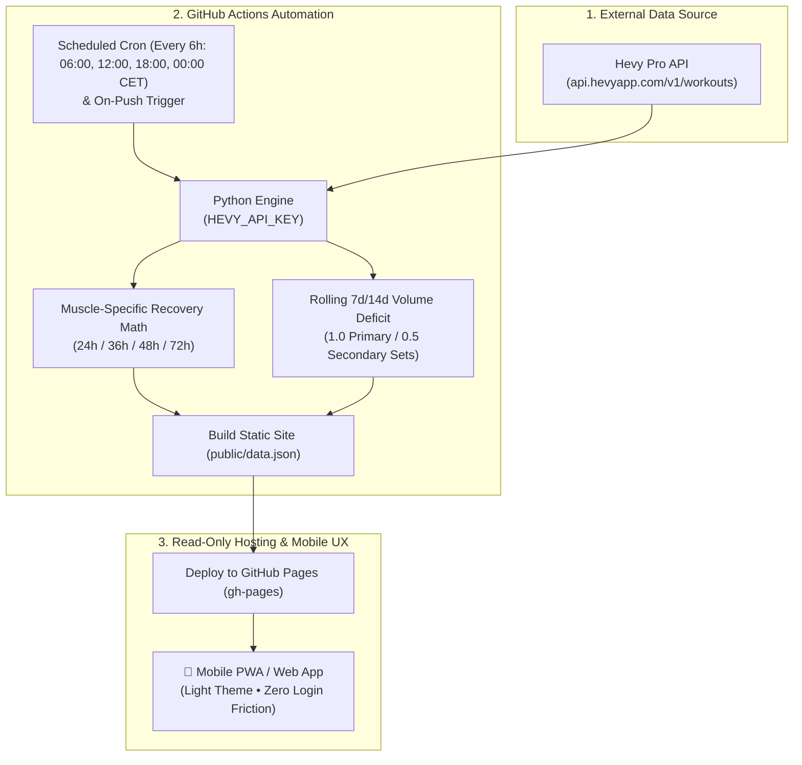

# Personal Trainer — Hevy Smart Guidance

An intelligent, low-friction mobile dashboard connected to your **Hevy Pro** workout logs. It tracks individual muscle recovery windows and rolling volume trends to answer one simple question before every session: **"What should I train today?"**

Hosted 100% read-only on GitHub Pages. Zero servers, zero host computer exposure, and zero manual maintenance.

---

## 🏛️ System Architecture

---

## 🧠 Core Engine & Logic Specification

### 1. Independent Muscle-Specific Recovery Model
* **No rigid workout splits**: You train intuitively on energy levels, but each muscle group tracks its own independent recovery clock based on muscular size and fatigue profiles.
* **Per-Muscle Recovery Thresholds**:
  * 🦵 **72 Hours**: Quads, Hamstrings
  * ⏱️ **48 Hours**: Chest, Lats, Upper / Mid Back, Triceps, Glutes, Calves, Hip Adductors, Hip Abductors
  * 💪 **36 Hours**: Biceps
  * ⚡ **24 Hours**: Shoulders, Abs / Core
* **Dynamic Readiness & Completion States**:
  * 🟢 **Ready** ($\text{hours} \ge \text{threshold}$ and $\text{deficit} > 0$): Muscle has rested and has volume left to train. Actionable for today.
  * 🟣 **Done** ($\text{deficit} = 0$): Weekly volume goal achieved. Muscle has been trained enough.
  * 🟡 **Recovering** ($\text{threshold}/2 \le \text{hours} < \text{threshold}$): Intermediate break in progress.
  * 🔴 **Resting** ($\text{hours} < \text{threshold}/2$): Recently trained; break in progress.
* *Example scenario*: A hard leg session puts Quads and Hamstrings into resting for 72 hours, while Upper Body muscles remain 🟢 **Ready**.

### 2. Primary & Secondary Muscle Set Weighting
* Exercises fetched from Hevy's official database are anatomically weighted:
  * **Primary Target Muscle**: Receives **1.0 set** credit.
  * **Secondary / Synergist Muscles**: Receive **0.5 set** credit (e.g. 3 sets of Bench Press gives 3.0 Chest sets and 1.5 Triceps sets).
* Both primary and secondary muscle engagements update their respective recovery clocks.

### 3. Rolling Volume Windows (7 & 14 Days)
* Instead of resetting on arbitrary calendar Mondays, volume is evaluated on a continuous **rolling 7-day window** (with a secondary 14-day window for long-term consistency).
* **Volume Deficit**:
  $$\text{Deficit} = \max(0, \text{Weekly Target Sets} - \text{Completed Sets in Last 7 Days})$$

### 4. "What to Train Today" Priority Algorithm
1. **Filter**: Identify all muscles currently in the 🟢 **Ready** state (met full individual recovery threshold).
2. **Sort**: Rank ready muscles by their **Volume Deficit** (highest deficit = highest training priority).
3. **Recommend**: Output the top 2–4 priority muscles as **"Today's Focus"**.

---

## 🎨 UI/UX Design (Light Theme)

* **Design Aesthetic**: Minimalist, clean, high-contrast light theme inspired by Apple Health and Linear.
* **Palette**:
  * Background: Pure white & soft slate (`#f8fafc`).
  * Typography: Deep navy/slate (`#0f172a`).
  * Badges: Vibrant green (`#10b981`), amber (`#f59e0b`), and blue accents.
* **Key Screen Sections**:
  1. **Top Recommendation Hero Card**: Actionable headline (e.g. *"Today's Focus: Quads, Lats, Chest"*).
  2. **View Toggle**: Quick switch between **7-Day Rolling** and **14-Day View**.
  3. **Muscle Readiness & Goal Grid**: Real-time cards displaying last trained time, status badge, and fractional set progress.
  4. **Recent Workouts Log**: Recent Hevy sessions with set totals and targeted muscle badges.

---

## 🌐 Live Web App & Mobile Access

The dashboard is continuously updated by GitHub Actions:

👉 **[https://apilaskowski.github.io/personal_trainer/](https://apilaskowski.github.io/personal_trainer/)**

### Add to Mobile Home Screen:
* **iPhone (Safari)**: Open the URL → tap Share → tap **"Add to Home Screen"**.
* **Android (Chrome)**: Open the URL → tap the `⋮` menu → tap **"Install App"** or **"Add to Home screen"**.
