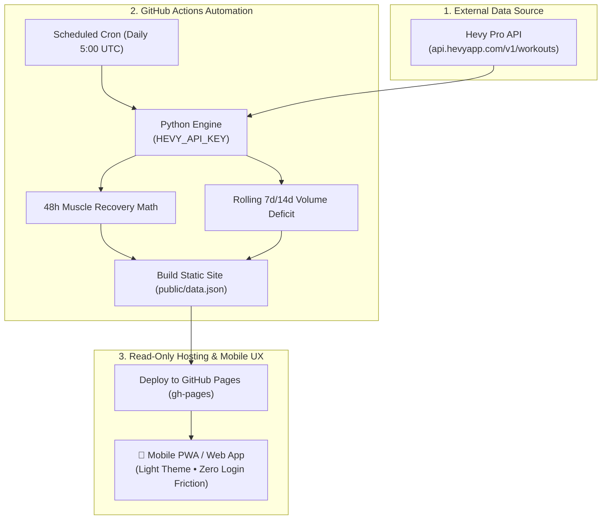

# Personal Trainer — Hevy Smart Guidance

An intelligent, low-friction mobile dashboard connected to your **Hevy Pro** workout logs. It tracks muscle recovery and volume trends to answer one simple question before every session: **"What should I train today?"**

Hosted 100% read-only on GitHub Pages. Zero servers, zero host computer exposure, and zero maintenance.

---

## 🏛️ System Architecture

---

## 🧠 Core Engine & Logic Specification

### 1. Independent 48-Hour Muscle Recovery Model
* **No rigid workout splits**: You train on "vibes" and energy levels, but each muscle group tracks its own recovery clock.
* **Granular muscle tracking**:
  * **Lower Body**: Quads, Hamstrings, Glutes, Calves.
  * **Upper Body**: Chest, Back (Lats & Upper Back), Shoulders (Front/Side/Rear).
  * **Arms & Core**: Biceps, Triceps, Abs/Core.
* **Recovery States**:
  * 🟢 **Ready** ($\ge 48$ hours rested): Muscle has fully supercompensated and is primed for training.
  * 🟡 **Recovering** ($24 - 48$ hours rested): Intermediate recovery.
  * 🔴 **Resting** ($< 24$ hours rested): Recently trained; needs full rest.
* *Example scenario*: If you train Quads on Monday but skip Hamstrings, on Tuesday Hamstrings remain 🟢 **Ready**, while Quads go into 🔴 **Resting**.

### 2. Rolling Volume Windows (7 & 14 Days)
* Instead of resetting on arbitrary calendar Mondays, volume is evaluated on a **rolling 7-day window** (with a secondary 14-day window for long-term trend analysis).
* **Volume Deficit**:
  $$\text{Deficit} = \max(0, \text{Weekly Target Sets} - \text{Completed Sets in Last 7 Days})$$

### 3. "What to Train Today" Priority Algorithm
1. **Filter**: Identify all muscles currently in the 🟢 **Ready** state ($\ge 48$h rest).
2. **Sort**: Rank ready muscles by their **Volume Deficit** (highest deficit = highest priority).
3. **Recommend**: Output the top 2–4 priority muscles as **"Today's Focus"**.

---

## 🎨 UI/UX Design (Light Theme)

* **Design Aesthetic**: Minimalist, clean, high-contrast light theme (Apple Health & Linear inspired).
* **Palette**:
  * Background: Pure white & soft slate (`#f8fafc`).
  * Typography: Crisp deep navy/slate (`#0f172a`).
  * Badges: Vibrant green (`#10b981`), amber (`#f59e0b`), and blue accents.
* **Key Screen Sections**:
  1. **Top Recommendation Hero Card**: Clear headline (e.g. *"Today's Focus: Hamstrings, Back, Shoulders"*).
  2. **View Toggle**: Quick switch between **7-Day Rolling** and **14-Day View**.
  3. **Muscle Readiness & Goal Grid**: Individual cards showing last trained timestamp, recovery status, and set progress bar.
  4. **Recent Workouts Log**: Clean breakdown of recent Hevy sessions.

---

## 🗺️ Phased Implementation Roadmap

Development was broken down into 5 focused steps:

- [x] **Step 1: Architecture & Design Specification** (#2)  
  Document system architecture, recovery math, data models, and UI wireframes.
- [x] **Step 2: Hevy API Client & Exercise Mapping** (#3)  
  Implement `src/hevy_client.py` with pagination, error handling, muscle taxonomy, and offline mock support.
- [x] **Step 3: Recovery & Recommendation Engine** (#4)  
  Implement `src/analyzer.py` with unit tests for 48h recovery calculations and rolling set volume.
- [x] **Step 4: Mobile-First Light Theme Web App** (#5)  
  Build `public/index.html`, `style.css`, and `app.js` with responsive layout and PWA support.
- [x] **Step 5: GitHub Actions Daily Sync & GitHub Pages Deployment** (#6)  
  Configure `.github/workflows/sync-and-deploy.yml` with scheduled cron and automatic deployment.

---

## 🌐 Live Web App & Mobile Access

Once merged to `main`, GitHub Actions automatically compiles and publishes the dashboard to GitHub Pages:

👉 **`https://apilaskowski.github.io/personal_trainer/`**

### One-Time Setup on GitHub:
1. Go to repository **Settings** → **Pages**.
2. Under **Build and deployment** → **Source**, select **Deploy from a branch**.
3. Select branch: **`gh-pages`** (folder: `/root`), then click **Save**.
*(The `gh-pages` branch is created automatically on the first workflow run).*

### Add to Mobile Home Screen:
* **iPhone (Safari)**: Open the URL → tap the Share button (square with arrow) → tap **"Add to Home Screen"**.
* **Android (Chrome)**: Open the URL → tap the `⋮` menu → tap **"Install App"** or **"Add to Home screen"**.
